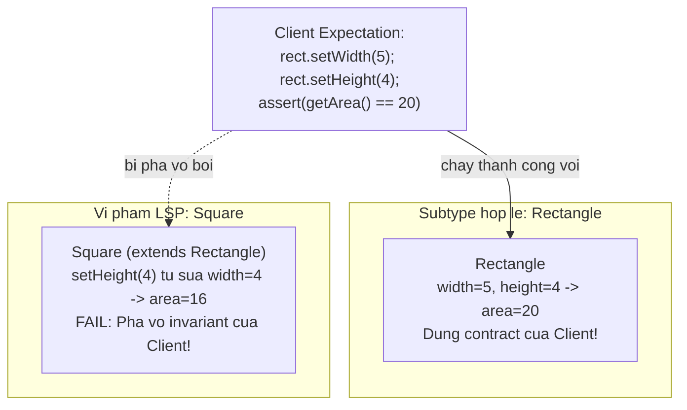
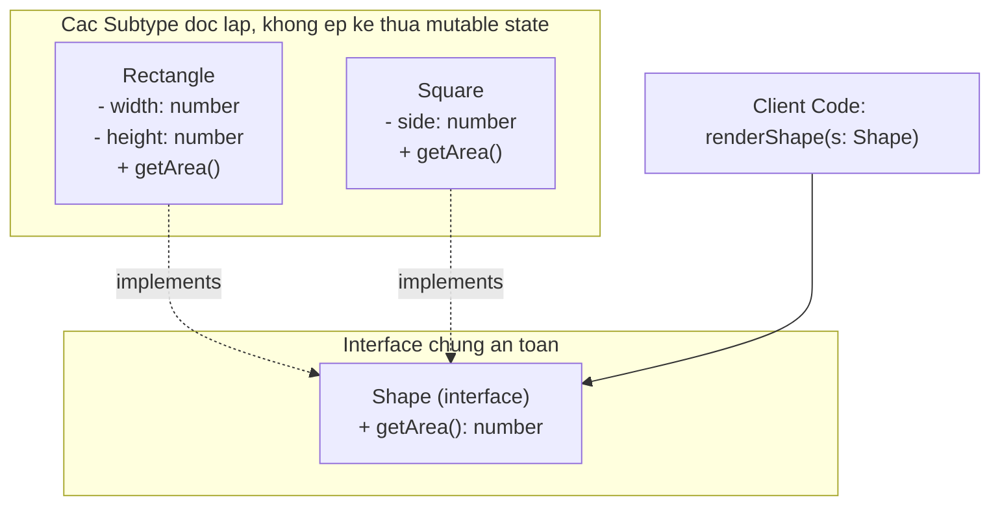

# Liskov Substitution Principle (LSP)

Barbara Liskov, *A Behavioral Notion of Subtyping* (1987):

> **"If S is a subtype of T, then objects of type T may be replaced with objects of type S without altering any of the desirable properties of the program."**

Robert C. Martin diễn giải thực tế: **Lớp con không được phá vỡ bất kỳ kỳ vọng hoặc hành vi nào mà lớp cha đã cam kết với client.**

---

## 1. Bài toán Square-Rectangle

Trong hình học: *"Mọi hình vuông đều là hình chữ nhật"* — quan hệ Is-A hoàn toàn đúng về mặt toán học. Nhưng trong OOP với *mutable behavior*, điều này dẫn đến lỗi:

```typescript
class Rectangle {
  constructor(protected width: number, protected height: number) {}

  setWidth(w: number): void { this.width = w; }
  setHeight(h: number): void { this.height = h; }
  getArea(): number { return this.width * this.height; }
}

// Hình vuông "là" hình chữ nhật — nhưng override hành vi vi phạm LSP
class Square extends Rectangle {
  setWidth(w: number): void {
    this.width = w;
    this.height = w; // để giữ tính vuông
  }
  setHeight(h: number): void {
    this.width = h;
    this.height = h;
  }
}

// Client code viết cho Rectangle
function resizeAndCheck(rect: Rectangle): void {
  rect.setWidth(5);
  rect.setHeight(4);
  // Client kỳ vọng: 5 * 4 = 20
  console.assert(rect.getArea() === 20, 'Wrong area!');
}

resizeAndCheck(new Rectangle(2, 3)); // Pass
resizeAndCheck(new Square(2, 2));    // FAIL! getArea() = 16 (4 * 4)
```

**Tại sao sai?**
- Về mặt **dữ liệu tĩnh (taxonomy):** Square Is-A Rectangle — đúng.
- Về mặt **hành vi biến đổi (mutable behavior):** Rectangle cam kết *"thay đổi width không ảnh hưởng height"*. Square âm thầm phá vỡ cam kết này → không phải subtype hợp lệ.

---

## 2. Bốn dấu hiệu vi phạm LSP phổ biến



### Dấu hiệu 1: Throw UnsupportedOperation

```typescript
class ReadOnlySqlRepository extends SqlRepository {
  save(entity: Entity): void {
    throw new Error('Read-only repo cannot save!'); // vi phạm LSP
  }
}
// Client gọi repo.save() — tin rằng nó sẽ lưu
// Nhận Exception thay vì hành vi đã cam kết
```

### Dấu hiệu 2: instanceof check

```typescript
function renderShape(shape: Shape): void {
  if (shape instanceof Circle) shape.drawCircle();
  else if (shape instanceof Square) shape.drawSquare();
  // Client không thể đối xử bình đẳng với các subtype → LSP bị phá
}
```

---

## 3. Giải pháp: Design by Contract

Bertrand Meyer đưa ra 3 quy tắc cho subtype hợp lệ:

1. **Preconditions không được siết chặt hơn:** Nếu lớp cha nhận `int` từ -100 đến 100, lớp con không được thu hẹp thành 0 đến 100.
2. **Postconditions không được nới lỏng:** Nếu lớp cha cam kết balance không âm sau giao dịch, lớp con phải đảm bảo điều đó.
3. **Invariants phải được bảo toàn:** Mọi bất biến của lớp cha (ngày sinh < ngày hiện tại) phải được mọi lớp con duy trì.

---

## 4. Thiết kế lại đúng đắn

Khi Square không thể là subtype hợp lệ của Rectangle, đừng ép kế thừa — đưa về cùng một abstraction:

```typescript
// Interface chỉ expose hành vi cả hai đều cam kết được
interface Shape {
  getArea(): number;
}

class Rectangle implements Shape {
  constructor(private width: number, private height: number) {}
  getArea(): number { return this.width * this.height; }
}

class Square implements Shape {
  constructor(private side: number) {}
  getArea(): number { return this.side * this.side; }
}
```



Bất kỳ hàm nhận `Shape` chỉ kỳ vọng `getArea()` — cả `Rectangle` và `Square` đều đáp ứng đúng 100%.
