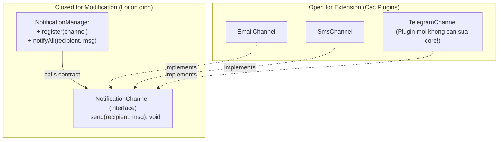
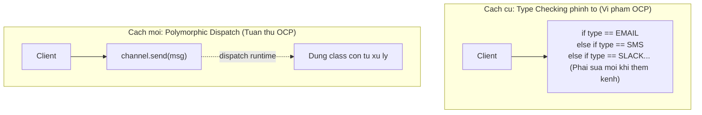

# Open/Closed Principle (OCP)

Bertrand Meyer, *Object-Oriented Software Construction* (1988). Robert C. Martin đưa vào SOLID:

> **"Software entities should be open for extension, but closed for modification."**
>
> *(Các thực thể phần mềm phải mở cho việc mở rộng tính năng, nhưng đóng đối với việc sửa đổi mã nguồn sẵn có.)*

**Mục tiêu thực tế:** Khi yêu cầu mới xuất hiện, bạn chỉ cần viết thêm code mới, không cần sửa đổi mã nguồn cũ đang chạy ổn định.

---

## 1. Vấn đề: Switch-case phình to theo thời gian

```typescript
class NotificationService {
  send(type: 'EMAIL' | 'SMS' | 'SLACK', message: string, recipient: string): void {
    if (type === 'EMAIL') {
      console.log(`Email to ${recipient}: ${message}`);
    } else if (type === 'SMS') {
      console.log(`SMS to ${recipient}: ${message}`);
    } else if (type === 'SLACK') {
      console.log(`Slack to ${recipient}: ${message}`);
    }
    // Yêu cầu mới: TELEGRAM, ZALO, PUSH_NOTIFICATION...
    // Mỗi lần thêm: phải MỞ file này ra SỬA
  }
}
```

**Hậu quả:**
- Mỗi lần mở `NotificationService` để sửa, có nguy cơ vô tình phá vỡ các kênh cũ (regression bug).
- Đội QA phải re-test toàn bộ các kênh cũ mỗi khi thêm kênh mới.
- Không thể đóng gói class thành thư viện tái sử dụng.

---

## 2. Giải pháp: Abstraction + Plugin Architecture

```typescript
// Abstraction ổn định — không bao giờ thay đổi
interface NotificationChannel {
  send(recipient: string, message: string): void;
}

// Các plugin cụ thể — mỗi loại là một file độc lập
class EmailChannel implements NotificationChannel {
  send(recipient: string, message: string): void {
    console.log(`[Email] ${recipient}: ${message}`);
  }
}

class SmsChannel implements NotificationChannel {
  send(recipient: string, message: string): void {
    console.log(`[SMS] ${recipient}: ${message}`);
  }
}

// Manager: đóng với sửa đổi, mở với extension
class NotificationManager {
  private channels: NotificationChannel[] = [];

  register(channel: NotificationChannel): void {
    this.channels.push(channel);
  }

  notifyAll(recipient: string, message: string): void {
    for (const ch of this.channels) {
      ch.send(recipient, message);
    }
  }
}
```

Khi cần thêm Telegram: tạo file `TelegramChannel.ts`, implement `NotificationChannel` — **không sửa bất kỳ file nào đã có**.



---

## 3. Cơ chế: Đa hình thay cho Type Checking

OCP hoạt động nhờ **Polymorphism** — thay vì `if type === X` kiểm tra tại runtime, mỗi class tự biết cách thực thi hành vi của mình.



---

## 4. Cảnh báo: Không thể đóng với mọi thay đổi

> [!WARNING]
> Không có hệ thống nào có thể "đóng" trước 100% mọi loại thay đổi. Cố gắng trừu tượng hóa mọi ngóc ngách để chuẩn bị cho những thứ không bao giờ đến là vi phạm **YAGNI**.
>
> **Chiến lược "Fool me once":**
> - Lần đầu viết: giải pháp đơn giản nhất.
> - Lần thứ hai có thay đổi tương tự: nhận diện trục biến động và refactor sang OCP ngay để bảo vệ các lần sau.
