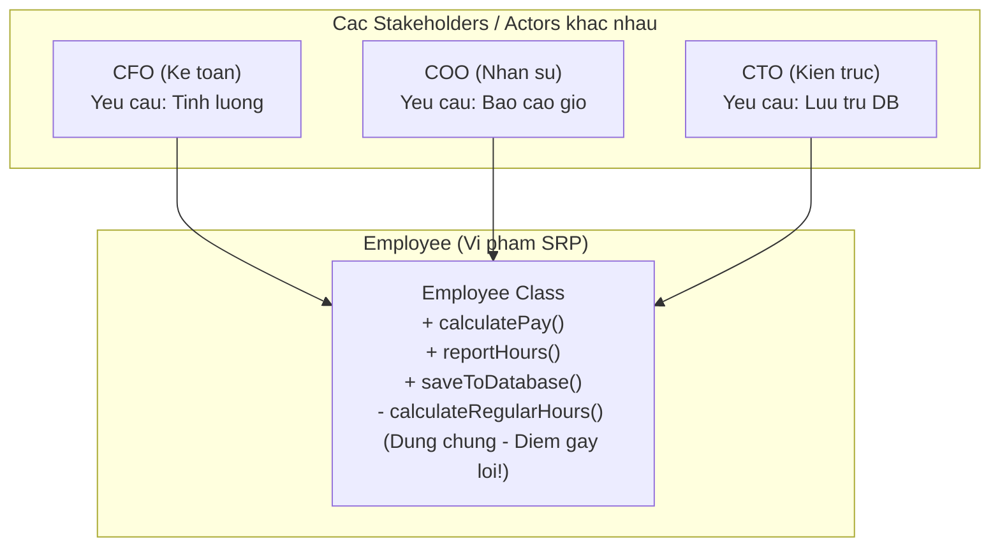
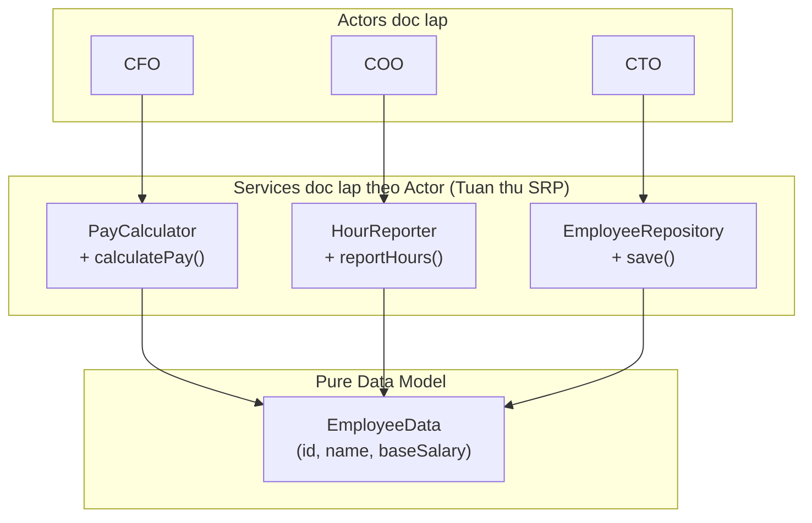

# Single Responsibility Principle (SRP)

Robert C. Martin, *Clean Architecture* (2017):

> **"A module should be responsible to one, and only one, actor."**
>
> *(Một module chỉ nên chịu trách nhiệm trước một, và chỉ một, tác nhân nghiệp vụ.)*

Định nghĩa phổ biến hơn nhưng dễ hiểu sai: *"Một class chỉ làm một việc"* — quá mơ hồ. Định nghĩa chính xác phải gắn với **Actor**.

---

## 1. Actor là gì?

**Actor** là nhóm người dùng hoặc stakeholder có quyền yêu cầu thay đổi một phần của hệ thống:

- **CFO (Kế toán):** yêu cầu thay đổi cách tính lương, thưởng.
- **COO (Nhân sự):** yêu cầu thay đổi cách tính ngày phép, chấm công.
- **CTO (Kỹ thuật):** yêu cầu thay đổi cấu trúc lưu trữ dữ liệu.

Nếu một class phục vụ đồng thời nhiều Actor, class đó vi phạm SRP.

---

## 2. Ví dụ vi phạm: Class Employee

```typescript
class Employee {
  constructor(
    public id: string,
    public name: string,
    public baseSalary: number
  ) {}

  // Actor: CFO — Kế toán
  calculatePay(): number {
    return this.baseSalary + this.calculateRegularHours() * 1.5;
  }

  // Actor: COO — Nhân sự
  reportHours(): string {
    return `${this.name}: ${this.calculateRegularHours()} hours`;
  }

  // Actor: CTO — Database
  saveToDatabase(): void {
    db.execute(`INSERT INTO employees VALUES (...)`, [this.id, this.name]);
  }

  // Dùng chung bởi CFO và COO — đây là bẫy!
  private calculateRegularHours(): number {
    return 40;
  }
}
```

**Bẫy nguy hiểm:** Nhân sự (COO) yêu cầu thay `calculateRegularHours()` cho nhân viên part-time. Lập trình viên sửa hàm này → `calculatePay()` của Kế toán (CFO) tính sai lương mà không ai phát hiện.



---

## 3. Giải pháp: Tách theo Actor

```typescript
// Cấu trúc dữ liệu thuần — không có logic
class EmployeeData {
  constructor(
    public readonly id: string,
    public readonly name: string,
    public readonly baseSalary: number
  ) {}
}

// Chịu trách nhiệm duy nhất trước CFO
class PayCalculator {
  calculatePay(emp: EmployeeData): number {
    const hours = this.getStandardAccountingHours();
    return emp.baseSalary + hours * 1.5;
  }
  private getStandardAccountingHours(): number { return 40; }
}

// Chịu trách nhiệm duy nhất trước COO
class HourReporter {
  reportHours(emp: EmployeeData): string {
    const hours = this.getHrStandardHours();
    return `${emp.name}: ${hours} hours`;
  }
  private getHrStandardHours(): number { return 40; }
}

// Chịu trách nhiệm duy nhất trước CTO
class EmployeeRepository {
  save(emp: EmployeeData): void {
    db.execute('INSERT INTO employees (id, name, salary) VALUES (?, ?, ?)',
      [emp.id, emp.name, emp.baseSalary]);
  }
}
```



Giờ đây:
- COO yêu cầu thay đổi cách tính giờ → chỉ `HourReporter` bị sửa, `PayCalculator` không bị ảnh hưởng.
- CTO đổi schema database → chỉ `EmployeeRepository` bị sửa.

---

## 4. Trade-off: Tránh phân mảnh cực đoan

> [!WARNING]
> SRP không có nghĩa là mỗi method thành một class. Nếu một class nhỏ, phục vụ một nhóm nghiệp vụ duy nhất, hãy giữ nguyên. Chỉ tách khi **các Actor khác nhau bắt đầu kéo class về các hướng khác nhau**.
