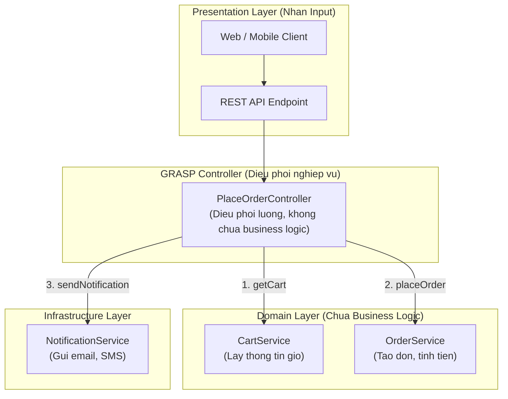

# GRASP: Controller

Craig Larman, *Applying UML and Patterns* (2004):

> **"Assign the responsibility for handling a system event message to a class representing one of these choices:**
> 1. **Represents the overall system, device, or subsystem (Facade Controller).**
> 2. **Represents a use-case scenario within which the system event occurs (Use Case Controller)."**

---

## 1. Vấn đề: UI trực tiếp gọi Domain

```typescript
// UI layer tự xử lý domain logic — sai
class CheckoutButton {
  onClick(): void {
    const cart = CartStore.getItems();
    let total = 0;
    for (const item of cart) {
      total += item.price * item.qty;
      if (item.isPromo) total *= 0.9; // domain logic trong UI!
    }
    const order = new Order(cart, total);
    OrderDB.save(order);               // persistence trong UI!
    EmailService.sendConfirmation(order);
  }
}
```

UI layer đang làm công việc của Domain. Khi logic thay đổi, phải sửa UI.

---

## 2. Hai loại Controller

**Use Case Controller:** Một Controller cho mỗi Use Case — phù hợp hệ thống phức tạp, nhiều nghiệp vụ.

```typescript
class PlaceOrderController {
  constructor(
    private cartService: CartService,
    private orderService: OrderService,
    private notificationService: NotificationService
  ) {}

  // Chỉ điều phối — không chứa domain logic
  async handle(customerId: string): Promise<OrderConfirmation> {
    const cart = await this.cartService.getCart(customerId);
    const order = await this.orderService.placeOrder(cart);
    await this.notificationService.sendConfirmation(order);
    return OrderConfirmation.from(order);
  }
}
```

**Facade Controller:** Một Controller cho toàn hệ thống hoặc subsystem — phù hợp hệ thống nhỏ.



---

## 3. Fat Controller — Triệu chứng và cách chữa

**Fat Controller** xuất hiện khi Controller bắt đầu chứa domain logic:

```typescript
// Fat Controller — chứa quá nhiều business logic
class OrderController {
  async placeOrder(request: PlaceOrderRequest): Promise<void> {
    // Validation phức tạp thuộc về Domain
    if (request.items.length === 0) throw new Error('Cart empty');
    if (request.total < 0) throw new Error('Invalid total');

    // Tính discount — thuộc về Domain
    let total = request.total;
    if (request.voucherCode === 'SALE20') total *= 0.8;

    // Gọi trực tiếp DB — thuộc về Repository
    await db.query('INSERT INTO orders ...', [total]);
  }
}
```

**Giải pháp:** Di chuyển domain logic xuống Domain Objects, persistence logic sang Repository:

```typescript
// Lean Controller — chỉ điều phối
class OrderController {
  async placeOrder(request: PlaceOrderRequest): Promise<void> {
    const command = PlaceOrderCommand.from(request); // validate và map
    await this.placeOrderUseCase.execute(command);    // delegate to domain
  }
}
```

---

## 4. Controller KHÔNG phải là bộ phận của Domain

> [!IMPORTANT]
> Controller là **điểm giao tiếp** giữa tầng trình bày (UI, API, CLI) và tầng domain. Nó điều phối (coordinate), không xử lý (process). Mọi business rule phải nằm trong Domain Objects hoặc Domain Services.
