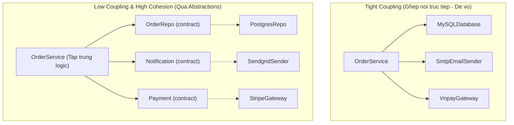

# GRASP: Low Coupling & High Cohesion

Low Coupling và High Cohesion không chỉ là hai trong 9 mẫu GRASP. Chúng là **hai thước đo nền tảng nhất của thiết kế phần mềm tốt**. Mọi nguyên lý khác — từ SOLID, Clean Code đến Microservices — đều là phương tiện để đạt hai mục tiêu này.

---

## 1. Coupling — Mức độ ghép nối

> **Coupling đo lường mức độ một module phụ thuộc, hiểu biết và gắn chặt vào các module khác.**

**Tight Coupling:** Class A phụ thuộc trực tiếp vào cấu trúc chi tiết bên trong Class B. Thay đổi nhỏ ở B → A bị vỡ ngay.

**Low Coupling:** Class A chỉ giao tiếp với B qua một interface ổn định. A không biết B cài đặt thế nào bên trong.



### Các cấp độ Coupling (từ tệ đến tốt)

1. **Content Coupling (tệ nhất):** Class can thiệp và sửa dữ liệu `private` của class khác.
2. **Common/Global Coupling:** Nhiều class chia sẻ và sửa đổi biến toàn cục.
3. **Control Coupling:** Truyền flag `boolean` để điều khiển luồng bên trong class kia.
4. **Data Coupling (tốt nhất):** Chỉ trao đổi dữ liệu nguyên thủy hoặc DTO bất biến.

```typescript
// Control Coupling: caller "ra lệnh" cho callee làm gì
class ReportService {
  generate(data: Data, sendEmail: boolean): void {
    const report = this.build(data);
    if (sendEmail) this.emailService.send(report); // caller điều khiển logic bên trong
  }
}

// Data Coupling: caller chỉ cung cấp dữ liệu, tự quyết định gì cần làm
class ReportService {
  generate(data: Data): Report {
    return this.build(data); // chỉ làm đúng một việc
  }
}
const report = reportService.generate(data);
if (shouldSendEmail) emailService.send(report); // caller tự quyết
```

---

## 2. Cohesion — Tính kết dính

> **Cohesion đo lường mức độ các phương thức và thuộc tính bên trong một module gắn bó với nhau để thực hiện một mục tiêu duy nhất.**

**Low Cohesion:** Class `Utils` chứa hàm format ngày, gửi email, mã hóa mật khẩu và gọi database — không liên quan gì nhau.

**High Cohesion:** Mọi method trong class đều phục vụ một trách nhiệm nghiệp vụ rõ ràng.

### Thang đo Cohesion (Yourdon & Constantine)

| Cấp độ | Mô tả | Ví dụ |
|:---|:---|:---|
| **Coincidental (tệ nhất)** | Các method không có quan hệ gì | Class `Utils` tổng hợp |
| **Logical** | Cùng nhóm chức năng bề ngoài | Class chứa mọi thứ liên quan I/O |
| **Temporal** | Chạy cùng thời điểm (khởi động app) | Class `AppInitializer` |
| **Communicational** | Cùng thao tác trên một tập dữ liệu | — |
| **Sequential** | Output hàm này là input hàm kia | Pipeline |
| **Functional (tốt nhất)** | Tất cả cùng phục vụ một mục tiêu | `OrderCalculator` |

---

## 3. Cân bằng — Đừng đẩy về cực đoan

> [!CAUTION]
> **Coupling = 0 là hệ thống vô dụng.** Các class không tương tác nhau thì không tạo ra phần mềm hoạt động. Mục tiêu là **coupling cần thiết ở mức tối thiểu, trên abstraction ổn định**.
>
> **High Cohesion cực đoan** = chẻ mỗi method thành một class → 10.000 file cho một tính năng nhỏ. Độ phức tạp không biến mất, chỉ di chuyển từ *bên trong class* sang *kết nối giữa các class*.

| Trạng thái | Hậu quả | Hướng xử lý |
|:---|:---|:---|
| **Low Cohesion + Tight Coupling** | Spaghetti Code, Big Ball of Mud | Refactor với SRP và Information Expert |
| **High Cohesion + Tight Coupling** | Class tập trung nhưng dính chặt nhau | Áp dụng DIP và Interface |
| **High Cohesion + Low Coupling** | Kiến trúc lý tưởng | Duy trì qua Unit Test và Code Review |
