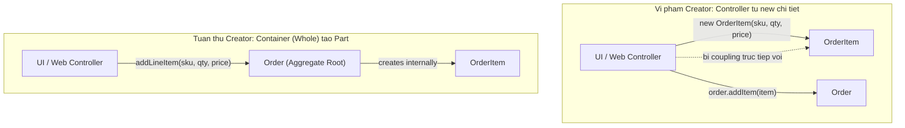

# GRASP: Creator

Craig Larman, *Applying UML and Patterns* (2004):

> **"Assign class B the responsibility of creating an instance of class A if one or more of the following is true:**
> 1. **B 'contains' or compositely aggregates A.**
> 2. **B records A.**
> 3. **B closely uses A.**
> 4. **B has the initializing data for A."**

---

## 1. Câu hỏi dẫn đường

Khi hệ thống cần tạo một object mới, câu hỏi Creator trả lời:

**"Ai nên chịu trách nhiệm khởi tạo instance này?"**

Không phải lúc nào cũng đặt `new` ở một chỗ tập trung. Creator giúp xác định class tự nhiên nhất để làm việc này.

---

## 2. Bốn điều kiện Creator

Class **B** là Creator hợp lệ của class **A** nếu:



---

## 3. Ví dụ: Order tạo OrderItem

**Ngữ cảnh:** Ai nên tạo `OrderItem`?

Kiểm tra 4 điều kiện với `Order`:
1. ✅ `Order` **contains** `OrderItem` — quan hệ composition.
2. ✅ `Order` **records** danh sách `OrderItem` của nó.
3. ✅ `Order` **closely uses** `OrderItem` để tính tổng.
4. ✅ `Order` **có đủ data** (productId, quantity, price) để khởi tạo `OrderItem`.

→ **`Order` là Creator tự nhiên của `OrderItem`**.

```typescript
class Order {
  private items: OrderItem[] = [];

  // Order là Creator của OrderItem
  addItem(productId: string, price: number, quantity: number): void {
    const item = new OrderItem(productId, price, quantity); // Order tạo
    this.items.push(item);
  }

  getTotalAmount(): number {
    return this.items.reduce((sum, item) => sum + item.getSubtotal(), 0);
  }
}
```

---

## 4. Khi nào cần Factory thay vì Creator?

Creator hoạt động tốt khi tạo object đơn giản. Cần **Factory** hoặc **Builder** khi:

- Logic khởi tạo phức tạp, nhiều biến thể.
- Cần cache hoặc reuse object.
- Object cần inject dependency từ IoC Container.
- Muốn tách rời người tạo và cấu hình creation logic.

```typescript
// Thay vì Order tự new OrderItem với logic phức tạp
class OrderItemFactory {
  constructor(private priceService: PriceService) {}

  create(productId: string, quantity: number): OrderItem {
    const price = this.priceService.getPrice(productId); // cần service ngoài
    const discount = this.priceService.getDiscount(productId);
    return new OrderItem(productId, price, quantity, discount);
  }
}
```

> [!NOTE]
> **Creator** là hướng dẫn mặc định cho object đơn giản trong cùng aggregate. **Factory** là giải pháp khi Creator dẫn đến coupling không mong muốn.
