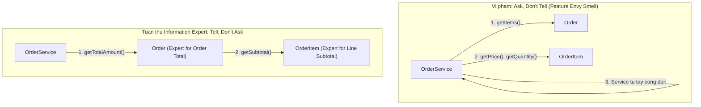

# GRASP: Information Expert

Craig Larman, *Applying UML and Patterns* (2004):

> **"Assign a responsibility to the class that has the information needed to fulfill it."**
>
> *(Giao trách nhiệm cho class có đủ thông tin cần thiết để thực hiện nó.)*

---

## 1. Câu hỏi dẫn đường

Khi thiết kế hệ thống và cần thêm một nghiệp vụ, Information Expert trả lời:

**"Ai biết những gì cần để thực hiện trách nhiệm này?"**

Class nào có đủ thông tin (hoặc có thể lấy đủ thông tin từ các collaborators của mình) — class đó là Expert và nên nhận trách nhiệm.

---

## 2. Ví dụ: Tính tổng đơn hàng

**Ngữ cảnh:** Hệ thống bán hàng cần tính tổng giá trị đơn hàng.

**Ai có thông tin để tính?**
- `Order` biết danh sách `OrderItem` của nó.
- `OrderItem` biết `price` và `quantity` của nó.

→ **`Order` là Expert để tính `totalAmount()`**, và ủy thác tính subtotal về từng `OrderItem`.

```typescript
class OrderItem {
  constructor(
    private readonly productName: string,
    private readonly price: number,
    private readonly quantity: number
  ) {}

  // OrderItem là Expert cho subtotal của chính nó
  getSubtotal(): number {
    return this.price * this.quantity;
  }
}

class Order {
  constructor(private readonly items: OrderItem[]) {}

  // Order là Expert cho total — nó biết tất cả items
  getTotalAmount(): number {
    return this.items.reduce((sum, item) => sum + item.getSubtotal(), 0);
  }
}
```

**Thay vì để `OrderService` lấy dữ liệu ra tính:**

```typescript
// Vi phạm Information Expert — Service biết quá nhiều về cấu trúc nội bộ
class OrderService {
  calculateTotal(order: Order): number {
    let total = 0;
    for (const item of order.items) {   // lấy dữ liệu nội bộ ra ngoài
      total += item.price * item.quantity;
    }
    return total;
  }
}
```

---

## 3. Kết nối với "Tell, Don't Ask"

Information Expert thực hiện nguyên lý **Tell, Don't Ask**:
- **Ask (sai):** Lấy dữ liệu từ object ra, tự tính toán bên ngoài.
- **Tell (đúng):** Yêu cầu object tự thực hiện nghiệp vụ với dữ liệu của chính nó.



---

## 4. Giới hạn: Khi Expert tạo ra High Coupling

> [!WARNING]
> Information Expert không phải lúc nào cũng đúng. Nếu giao trách nhiệm cho Expert tự nhiên dẫn đến **High Coupling** hoặc **Low Cohesion** — ví dụ Expert cần import hàng chục module không liên quan — thì cần xem xét **Pure Fabrication** (tạo class dịch vụ nhân tạo) thay thế.
>
> Ví dụ: `Order` không nên tự gửi email xác nhận dù nó có đủ thông tin để làm điều đó — vì gửi email là infrastructure concern, không phải domain concern.
