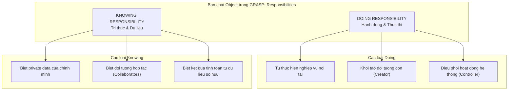
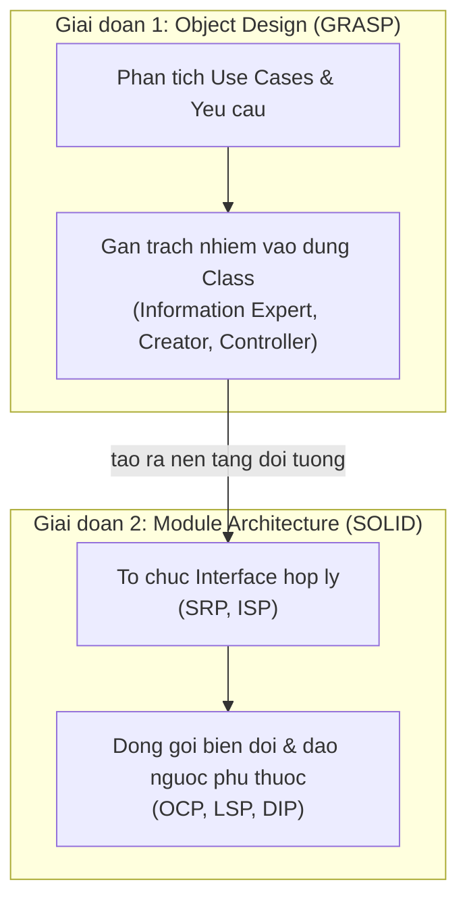

# GRASP: Hệ thống Gán Trách nhiệm

Craig Larman, *Applying UML and Patterns* (2004):

SOLID giúp trả lời "Làm sao để thay đổi không phá vỡ hệ thống?" — nhưng khi ngồi trước một trang giấy trắng, câu hỏi thực sự đầu tiên là:

> **"Hệ thống có một việc cần làm. Vậy CLASS NÀO nên chịu trách nhiệm làm việc đó?"**

**GRASP (General Responsibility Assignment Software Patterns)** được sinh ra để trả lời câu hỏi này.

---

## 1. Trách nhiệm trong OOP là gì?

Trong GRASP, một đối tượng được định nghĩa bởi **Trách nhiệm (Responsibilities)** của nó — không chỉ là dữ liệu nó chứa:

Thiết kế OOP thực chất là: **Phân rã Use Cases thành Trách nhiệm nhỏ → Gán (assign) mỗi trách nhiệm vào class phù hợp nhất**.

---

## 2. GRASP vs SOLID

| Tiêu chí | GRASP | SOLID |
|:---|:---|:---|
| **Mục tiêu** | Gán trách nhiệm: class nào làm việc này? | Cấu trúc module: làm sao để dễ mở rộng, bền vững? |
| **Thời điểm áp dụng** | Thiết kế ban đầu (Object Identification) | Tinh chỉnh kiến trúc, refactoring |
| **Câu hỏi dẫn đường** | *"Ai nên làm việc này?"* | *"Làm sao thay đổi không phá vỡ hệ thống?"* |
| **Mức trừu tượng** | Hành vi và quan hệ giữa objects | Cấu trúc interface và luồng phụ thuộc |

---

## 3. 9 Mẫu GRASP

Craig Larman chia thành hai nhóm:

**Nhóm cơ bản:**

| # | Pattern | Câu hỏi trả lời |
|:---|:---|:---|
| 1 | **Information Expert** | Ai có dữ liệu đủ để thực hiện trách nhiệm này? |
| 2 | **Creator** | Ai nên khởi tạo instance của class X? |
| 3 | **Controller** | Ai tiếp nhận và điều phối event từ UI? |
| 4 | **Low Coupling** | Làm sao giảm phụ thuộc giữa các class? |
| 5 | **High Cohesion** | Làm sao giữ class tập trung và dễ hiểu? |

**Nhóm nâng cao:**

| # | Pattern | Câu hỏi trả lời |
|:---|:---|:---|
| 6 | **Polymorphism** | Làm sao xử lý biến thể hành vi không dùng if-else? |
| 7 | **Pure Fabrication** | Khi nào tạo class "nhân tạo" không có trong domain? |
| 8 | **Indirection** | Làm sao tránh ghép nối trực tiếp giữa hai class? |
| 9 | **Protected Variations** | Làm sao bảo vệ hệ thống trước những điểm hay thay đổi? |

---

## 4. GRASP và SOLID bổ sung cho nhau

GRASP là **la bàn khi thiết kế từ đầu**. SOLID là **thước đo khi tinh chỉnh và refactor**. Kỹ sư thành thạo cần cả hai.
