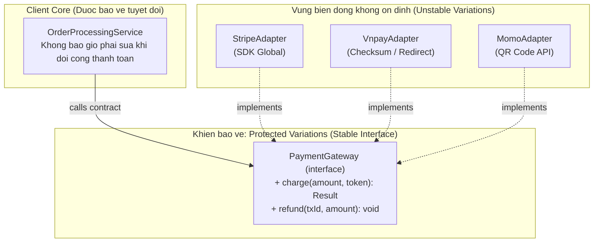

# GRASP: Protected Variations

Craig Larman, *Applying UML and Patterns* (2004):

> **"Identify points of predicted variation or instability; assign responsibilities to create a stable interface around them."**
>
> *(Xác định các điểm biến động dự báo trước; gán trách nhiệm tạo ra giao diện ổn định bao quanh chúng.)*

Protected Variations là mẫu GRASP tổng quát nhất — nó bao trùm tư tưởng của **OCP**, **Information Hiding** của David Parnas (1972), và **Encapsulate What Varies** của GoF.

---

## 1. Điểm Không ổn định (Points of Instability)

Một điểm không ổn định là bất cứ thứ gì **có thể thay đổi theo thời gian** và nếu thay đổi sẽ tạo ra ripple effect — buộc nhiều nơi khác phải sửa theo:



---

## 2. Khiên bảo vệ (Stable Interface)

Protected Variations giải quyết bằng cách đặt một **interface ổn định** (hợp đồng không đổi) giữa client và điểm biến động:

```
Client → [Stable Interface / Contract] → Implementation (có thể thay đổi)
```

```typescript
// Điểm biến động: Payment Gateway thay đổi theo thời gian
// (Stripe, PayPal, VNPay, MoMo...)

// Khiên bảo vệ: interface ổn định
interface PaymentGateway {
  charge(amount: number, currency: string, token: string): Promise<PaymentResult>;
  refund(transactionId: string, amount: number): Promise<void>;
}

// Client (OrderService) chỉ biết contract — không biết gateway cụ thể
class OrderService {
  constructor(private gateway: PaymentGateway) {}

  async processPayment(order: Order, paymentToken: string): Promise<void> {
    const result = await this.gateway.charge(
      order.total, order.currency, paymentToken
    );
    order.markAsPaid(result.transactionId);
  }
}

// Implementation thay đổi tự do — không ảnh hưởng OrderService
class StripeGateway implements PaymentGateway { /* ... */ }
class VNPayGateway implements PaymentGateway { /* ... */ }
```

---

## 3. Parnas Decomposition — Nguồn gốc lý thuyết

David Parnas (1972) trong paper *"On the Criteria To Be Used in Decomposing Systems into Modules"* đề xuất:

> **Phân rã hệ thống thành module dựa trên việc mỗi module giấu đi một quyết định thiết kế có thể thay đổi.**

Đây chính là tư tưởng gốc của Protected Variations: **module = khiên bảo vệ trước một quyết định thiết kế không ổn định**.

---

## 4. Protected Variations vs OCP

| | Protected Variations | OCP |
|:---|:---|:---|
| **Nguồn gốc** | GRASP (Craig Larman) | SOLID (Robert C. Martin) |
| **Mức độ** | Mẫu thiết kế object-level | Nguyên lý kiến trúc module-level |
| **Câu hỏi** | Điểm nào không ổn định, cần khiên? | Module có đang bị sửa khi mở rộng không? |
| **Kết quả** | Interface ổn định bao quanh điểm biến động | Mở rộng qua class mới, không sửa class cũ |

Hai khái niệm này **giải quyết cùng bài toán** ở các mức trừu tượng khác nhau.

> [!TIP]
> Protected Variations yêu cầu **dự báo chính xác** điểm nào sẽ thay đổi — dự báo sai dẫn đến over-engineering. Kết hợp với YAGNI: chỉ đặt khiên khi bạn có lý do cụ thể tin rằng điểm đó SẼ thay đổi.
