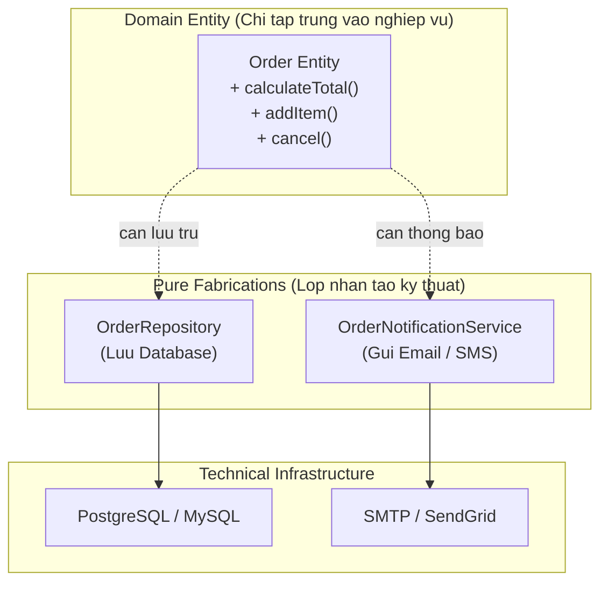
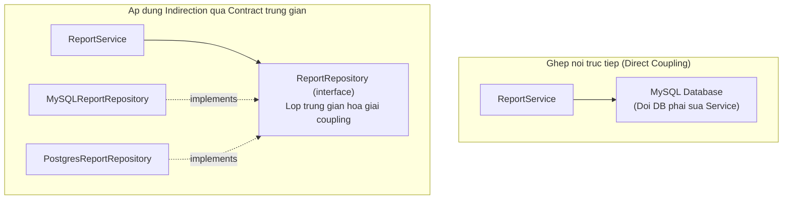

# GRASP: Pure Fabrication & Indirection

---

## Phần 1: Pure Fabrication

Craig Larman:

> **"Assign a highly cohesive set of responsibilities to an artificial or convenience class that does not represent a problem domain concept — something made up, to support high cohesion, low coupling, and reuse."**

### Vấn đề: Domain Object làm quá nhiều thứ

Nếu áp dụng Information Expert cứng nhắc, `Order` sẽ phải tự lưu vào database, tự gửi email, tự generate PDF. Điều này phá vỡ High Cohesion — `Order` làm quá nhiều việc không liên quan đến domain.

### Giải pháp: Tạo class nhân tạo

```typescript
// Các class này không tồn tại trong domain thực tế (không phải "Order", "Customer")
// Chúng được tạo ra để đạt High Cohesion & Low Coupling

// Pure Fabrication: Repository
class OrderRepository {
  async save(order: Order): Promise<void> {
    await this.db.query('INSERT INTO orders...', order.toDbRow());
  }
}

// Pure Fabrication: Service
class OrderNotificationService {
  async sendConfirmation(order: Order): Promise<void> {
    await this.emailClient.send({
      to: order.customerEmail,
      subject: 'Order Confirmed',
      body: this.buildEmailBody(order),
    });
  }
}
```



**Ví dụ các Pure Fabrication phổ biến:**
- `Repository` — persistence, không có trong domain thực tế.
- `Service` — nghiệp vụ không thuộc về một Entity cụ thể.
- `Adapter` — chuyển đổi giữa hai interface không tương thích.
- `Factory` — logic khởi tạo phức tạp.
- `Mapper` — chuyển đổi giữa domain object và DTO/DB row.

---

## Phần 2: Indirection

Craig Larman:

> **"Assign the responsibility of mediation between two elements to an intermediate object to avoid direct coupling between them."**

### Vấn đề và Giải pháp Indirection



`ReportService` chỉ biết đến `ReportRepository` interface — không bao giờ bị ảnh hưởng khi đổi database.

### Indirection và DIP

Indirection chính là cơ chế triển khai của **Dependency Inversion Principle** ở mức thiết kế object. DIP là nguyên lý *kiến trúc* — Indirection là mẫu *thiết kế* thực thi nguyên lý đó.

> [!NOTE]
> **Pure Fabrication** và **Indirection** thường đi cùng nhau: một Pure Fabrication thường đồng thời đóng vai trò Indirection object — ví dụ `Repository` vừa là class nhân tạo (không có trong domain) vừa là lớp trung gian giữa Domain và Database.
