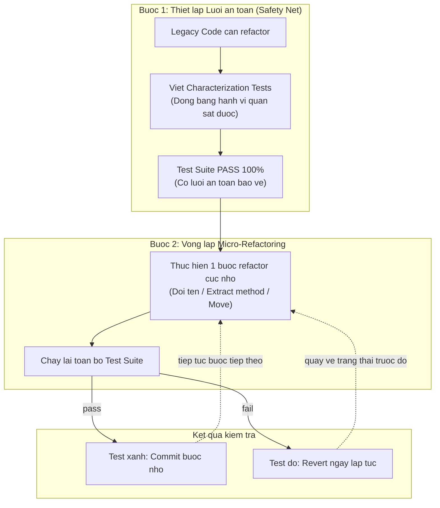

# Refactoring to Clean OOP

Martin Fowler, *Refactoring* (2018):

> **"Refactoring is the process of changing a software system in such a way that it does not alter the external behavior of the code yet improves its internal structure."**

---

## 1. Nguyên tắc cốt lõi: Không thay đổi hành vi bên ngoài

Refactoring **không phải** là:
- Thêm tính năng mới trong khi tái cấu trúc.
- Sửa bug và refactor cùng lúc.
- Đổi tên chỉ vì thích tên khác.

Refactoring **là:**
- Cải thiện cấu trúc nội tại mà output và hành vi quan sát được hoàn toàn không đổi.
- Được xác minh bằng test suite chạy xanh trước và sau.

---

## 2. Safety Net: Test trước, Refactor sau



Nếu chưa có test: **viết Characterization Tests trước** — các test mô tả hành vi hiện tại (dù hành vi đó có thể sai về mặt nghiệp vụ). Mục đích là có lưới an toàn khi tái cấu trúc.

---

## 3. Thứ tự ưu tiên Refactoring

Không phải mọi code smell đều cần fix ngay. Ưu tiên theo mức độ ảnh hưởng:

| Mức độ | Code Smell | Refactoring Technique |
|:---|:---|:---|
| **Khẩn cấp** | God Class đang được tất cả team sửa | Extract Class → Delegation |
| **Cao** | Shotgun Surgery khi sửa business rule | Move to Single Source of Truth |
| **Trung bình** | Feature Envy — method sai class | Move Method |
| **Thấp** | Duplicate Code có thể DRY | Extract Function/Method |
| **Sau cùng** | Long Method, Magic Number | Inline, Extract Variable |

---

## 4. Kỹ thuật Refactoring cơ bản

### Extract Method

```typescript
// Trước: method dài với nhiều phần logic khác nhau
processOrder(order: Order): void {
  // Phần 1: Validate
  if (!order.customerId) throw new Error('No customer');
  if (order.items.length === 0) throw new Error('No items');

  // Phần 2: Tính toán
  const subtotal = order.items.reduce((s, i) => s + i.price * i.qty, 0);
  const tax = subtotal * 0.1;
  const total = subtotal + tax;

  // Phần 3: Lưu
  db.save({ ...order, total });
}

// Sau: mỗi phần được extract thành method riêng, dễ test độc lập
processOrder(order: Order): void {
  this.validateOrder(order);
  const total = this.calculateTotal(order);
  this.saveOrder(order, total);
}
```

### Move Method

```typescript
// Trước: Feature Envy — method trong OrderService nhưng chỉ dùng Order data
class OrderService {
  isEligibleForDiscount(order: Order): boolean {
    return order.total > 1_000_000 && order.itemCount > 5;
  }
}

// Sau: di chuyển về Order — nơi có đủ thông tin
class Order {
  isEligibleForDiscount(): boolean {
    return this.total > 1_000_000 && this.itemCount > 5;
  }
}
```

### Extract Class (từ God Object)

```typescript
// Trước: SystemManager quản lý cả email lẫn payroll
class SystemManager {
  smtpHost: string;
  sendEmail(to: string, body: string): void { /* ... */ }
  taxRate: number;
  calculateSalary(empId: string): number { /* ... */ }
}

// Sau: tách thành 2 class có Cohesion cao
class EmailService {
  constructor(private smtpHost: string) {}
  send(to: string, body: string): void { /* ... */ }
}

class PayrollService {
  constructor(private taxRate: number) {}
  calculateSalary(empId: string): number { /* ... */ }
}
```

---

## 5. Tránh những sai lầm phổ biến khi Refactor

> [!WARNING]
> 1. **Refactor và thêm tính năng cùng lúc** — tạo ra bộ diff không thể review và test.
> 2. **Refactor toàn bộ codebase cùng một lần** — "big bang refactoring" thường thất bại.
> 3. **Xóa code cũ quá sớm** — hãy để Delegation pattern tồn tại cho đến khi toàn bộ client migrate xong.
> 4. **Refactor không có test** — đây là thay đổi, không phải refactoring.
