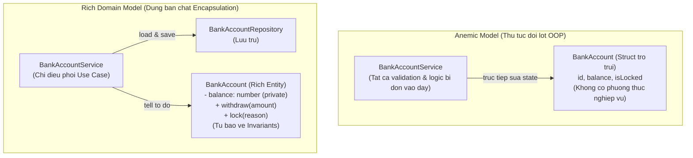

# Anemic Domain Model vs Rich Domain Model

Martin Fowler, *AnemicDomainModel* (martinfowler.com, 2003):

> **"The fundamental horror of this anti-pattern is that it's so contrary to the basic idea of object-oriented design; which is to combine data and process together."**

---

## 1. Anemic Domain Model là gì?

```typescript
// Entity trơ trụi — chỉ là C-style struct đội lốt class
class BankAccount {
  public id: string;
  public balance: number;
  public isLocked: boolean;
  public ownerId: string;
  // Không có bất kỳ hành vi nào
}

// Toàn bộ logic nghiệp vụ bị đẩy ra Service bên ngoài
class BankAccountService {
  withdraw(account: BankAccount, amount: number): void {
    if (account.isLocked) throw new Error('Account is locked');
    if (amount <= 0) throw new Error('Invalid amount');
    if (account.balance < amount) throw new Error('Insufficient funds');
    account.balance -= amount; // Service tự tay sửa dữ liệu nội bộ của Account
  }
}
```

**Vấn đề nghiêm trọng:**
- `account.balance = -9999999` có thể được viết từ bất kỳ đâu — không ai ngăn cản.
- `BankAccount` không có cơ chế tự bảo vệ Invariants của mình.
- Thực chất đây là **lập trình thủ tục** — `BankAccount` chỉ là struct, `BankAccountService` là tập hàm thao tác lên struct.

---

## 2. Rich Domain Model

```typescript
class BankAccount {
  private constructor(
    private readonly id: string,
    private balance: number,
    private isLocked: boolean = false
  ) {}

  // Factory method — đảm bảo object luôn ở trạng thái hợp lệ khi tạo
  static open(id: string, initialDeposit: number): BankAccount {
    if (initialDeposit < 0) throw new Error('Initial deposit cannot be negative');
    return new BankAccount(id, initialDeposit);
  }

  // Phương thức nghiệp vụ — tự kiểm tra và bảo vệ invariants
  withdraw(amount: number): void {
    if (this.isLocked) throw new Error('Cannot withdraw: account is locked');
    if (amount <= 0) throw new Error('Withdrawal amount must be positive');
    if (this.balance < amount) throw new Error('Insufficient funds');
    this.balance -= amount;
    // Có thể emit domain event tại đây
  }

  lock(reason: string): void {
    this.isLocked = true;
  }

  getBalance(): number {
    return this.balance; // read-only — không thể sửa trực tiếp từ ngoài
  }
}
```

**`BankAccountService`** giờ chỉ còn điều phối:
```typescript
class BankAccountService {
  async withdraw(accountId: string, amount: number): Promise<void> {
    const account = await this.repo.findById(accountId); // load từ DB
    account.withdraw(amount);                             // domain tự xử lý
    await this.repo.save(account);                        // lưu lại
  }
}
```

---

## 3. So sánh kiến trúc



| Tiêu chí | Anemic Domain Model | Rich Domain Model |
|:---|:---|:---|
| **Vị trí Logic** | Rải rác ở Service | Đóng gói trong Domain Entity |
| **Bảo vệ Invariants** | Không — ai cũng có thể sửa `balance` | Tuyệt đối — chỉ qua business method |
| **Tính OOP** | Thấp — thực chất là thủ tục | Cao — đúng bản chất Encapsulation |
| **Phù hợp với** | CRUD đơn giản, báo cáo tĩnh | Domain phức tạp: Core Banking, E-commerce |

---

## 4. Khi nào Anemic Model hợp lý?

> [!NOTE]
> Anemic Domain Model không phải lúc nào cũng sai. Nếu bạn xây dựng API báo cáo dữ liệu đơn thuần — không có quy tắc nghiệp vụ phức tạp — dùng DTO đơn giản và Service xử lý là hoàn toàn hợp lý và đủ.
>
> Vấn đề xảy ra khi áp dụng Anemic cho hệ thống có Domain **phức tạp và nhiều Invariants** cần bảo vệ — như hệ thống tài chính, thương mại điện tử, logistics.
