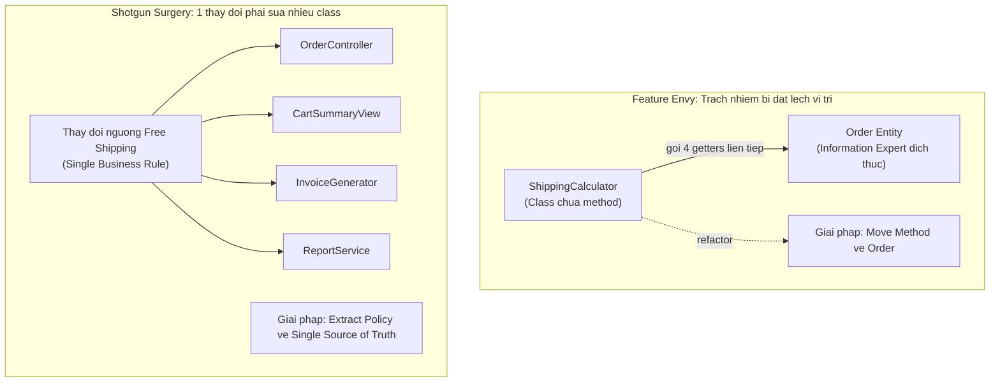

# Feature Envy & Shotgun Surgery

Martin Fowler, *Refactoring* (1999, 2018) — hai code smell quan trọng nhất chỉ ra **trách nhiệm bị đặt sai chỗ**.

---

## Phần 1: Feature Envy

> **"A function that seems more interested in a class other than the one it actually is in."**
>
> *(Một method có vẻ quan tâm đến class khác nhiều hơn class chứa nó.)*

### Nhận diện

Method trong `A` nhưng phần lớn thời gian lại gọi method/thuộc tính của `B`:

```typescript
class ShippingCalculator {
  // ShippingCalculator "ghen tị" với Order — nó muốn là method của Order
  calculate(order: Order): number {
    const baseRate = order.getWeight() * 2000;          // gọi Order
    const discount = order.isPremiumMember() ? 0.9 : 1; // gọi Order
    const surcharge = order.isFragile() ? 5000 : 0;     // gọi Order
    return baseRate * discount + surcharge;              // tất cả từ Order
  }
}
```

`ShippingCalculator.calculate()` biết quá nhiều về cấu trúc nội bộ của `Order` — đây là dấu hiệu logic này thuộc về `Order`.

### Giải pháp: Di chuyển method về đúng chỗ

```typescript
class Order {
  // Logic thuộc về Order — vì Order có đủ thông tin (Information Expert)
  calculateShipping(): number {
    const baseRate = this.weight * 2000;
    const discount = this.isPremiumMember ? 0.9 : 1;
    const surcharge = this.isFragile ? 5000 : 0;
    return baseRate * discount + surcharge;
  }
}
```

> [!NOTE]
> Không phải mọi Feature Envy đều cần fix bằng cách di chuyển method. Đôi khi method ở đúng chỗ nhưng cần một lớp trừu tượng mới (Strategy Pattern). Ưu tiên rõ ràng và đơn giản hơn là áp dụng pattern mọi lúc.

---

## Phần 2: Shotgun Surgery

> **"Every time you make a change, you have to make a lot of little changes to a lot of different classes."**
>
> *(Mỗi lần thay đổi một logic, bạn phải sửa nhiều class nhỏ rải rác khắp nơi.)*

### Nhận diện

Một quy tắc nghiệp vụ rải rác ở nhiều nơi — vi phạm DRY:

```typescript
// Quy tắc: đơn hàng premium được miễn phí vận chuyển
// Rải rác ở 4 nơi khác nhau:

// 1. OrderController
if (order.total > 500000) applyFreeShipping(order);

// 2. CartSummaryView
if (cart.total > 500000) showFreeShippingBadge();

// 3. InvoiceGenerator
if (invoice.subtotal > 500000) invoice.shippingFee = 0;

// 4. ReportService
if (order.value > 500000) report.shippingRevenue -= shippingFee;
```

Khi ngưỡng thay đổi từ 500.000đ sang 300.000đ: phải tìm và sửa 4 nơi — bỏ sót bất kỳ nơi nào, hệ thống không nhất quán.

### Giải pháp: Tập trung quy tắc vào Single Source of Truth

```typescript
class ShippingPolicy {
  static readonly FREE_SHIPPING_THRESHOLD = 500_000;

  static qualifiesForFreeShipping(orderTotal: number): boolean {
    return orderTotal >= this.FREE_SHIPPING_THRESHOLD;
  }
}

// Tất cả các nơi đều gọi ShippingPolicy
if (ShippingPolicy.qualifiesForFreeShipping(order.total)) applyFreeShipping(order);
```

---

## So sánh hai smell

| | Feature Envy | Shotgun Surgery |
|:---|:---|:---|
| **Triệu chứng** | Method ở sai class | Logic ở sai số lượng class |
| **Vấn đề gốc** | Trách nhiệm bị đặt sai nơi | Tri thức bị sao chép nhiều nơi |
| **Vi phạm nguyên lý** | Information Expert, High Cohesion | DRY, Single Source of Truth |
| **Giải pháp** | Move Method sang class phù hợp | Extract đến Single Source of Truth |


