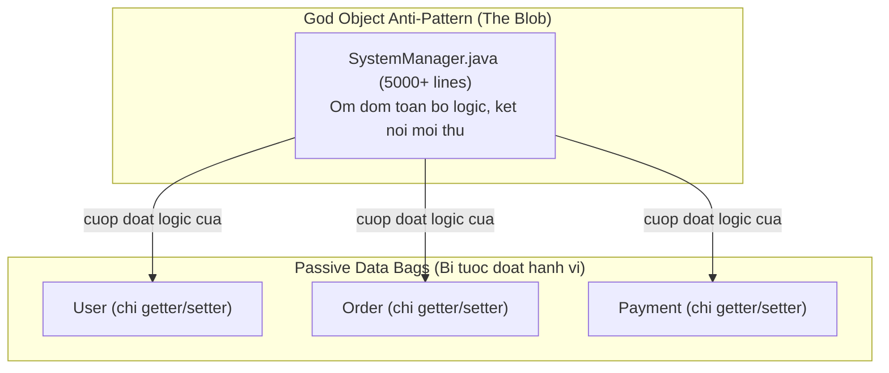
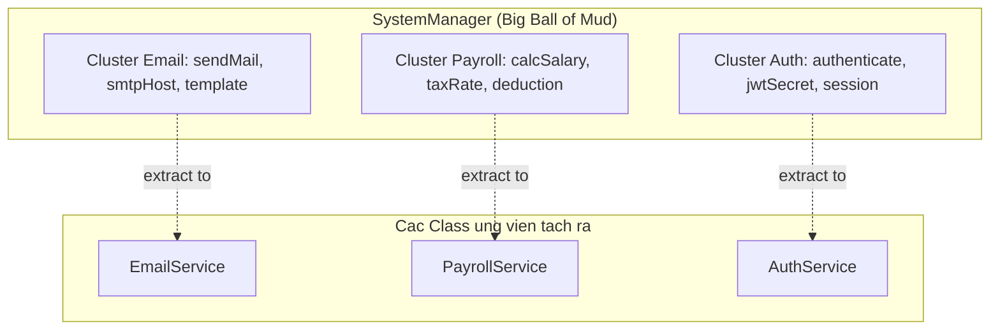
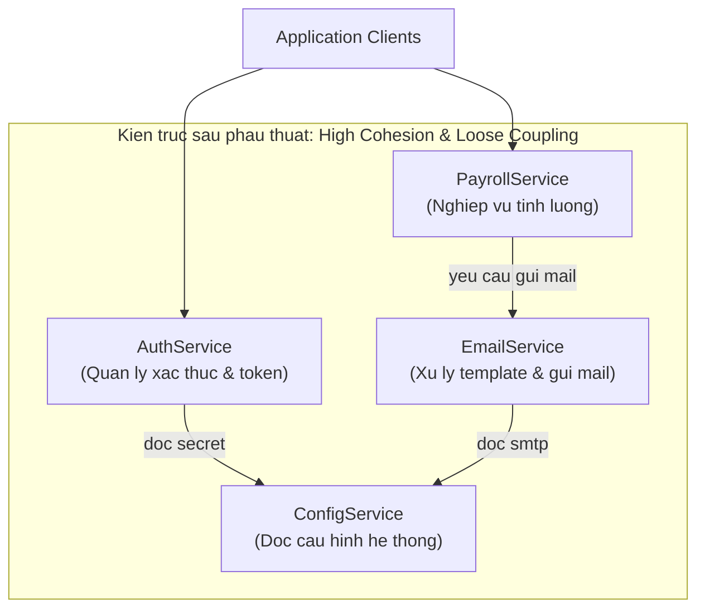

# The God Object: Căn Bệnh Class Ôm Đồm

Martin Fowler, *Refactoring* (2018) gọi đây là **Large Class**. Arthur Riel đặt tên **God Class** trong *Object-Oriented Design Heuristics* (1996). Cả hai mô tả cùng một anti-pattern:

> Một class biết quá nhiều hoặc làm quá nhiều — trái ngược hoàn toàn với High Cohesion và Single Responsibility.

---

## 1. Dấu hiệu nhận diện

- **Kích thước:** File dài 2.000 – 10.000+ dòng.
- **Tên quá chung:** `SystemManager`, `AppCoordinator`, `MainController`, `DataHandler`.
- **Biến thành viên cực lớn:** Hàng chục thuộc tính từ nhiều domain khác nhau.
- **Mọi class khác đều import nó:** Bất kỳ tính năng mới nào cũng phải gọi qua God Class.
- **Các class xung quanh trở thành Data Class thụ động:** Chỉ có getter/setter, toàn bộ tính toán bị thâu tóm vào God Object.



---

## 2. Tại sao God Object sinh ra?

1. **Lười suy nghĩ nơi đặt code mới:** Trong deadline gấp, nhét vào class này nhanh nhất vì đã có sẵn kết nối database, config, và mọi thứ.
2. **Tư duy thủ tục:** Người viết coi God Class như file `main()` khổng lồ — biến OOP thành thủ tục đội lốt class.
3. **Thiếu refactoring liên tục:** "Sẽ tái cấu trúc sau" — nhưng không bao giờ có "sau".

---

## 3. Lộ trình 4 bước phẫu thuật an toàn

God Class đang chạy trong production với hàng trăm nơi phụ thuộc — phải phẫu thuật thận trọng.

### Bước 1: Bao phủ bằng Characterization Tests

Trước khi đổi bất kỳ dòng code nào, viết Integration Test hoặc End-to-End Test "đóng băng" hành vi hiện tại. Đây là lưới an toàn — sau khi tách, chạy lại test để đảm bảo hành vi không đổi.

### Bước 2: Vẽ bản đồ Cohesive Clusters

Tìm nhóm method + attribute thường xuyên dùng cùng nhau:



Mỗi cluster là một class ứng viên sau khi tách.

### Bước 3: Extract Class

Tạo class mới cho mỗi cluster, chuyển method và attribute sang:

```typescript
// Cluster 1 → EmailService
class EmailService {
  constructor(private smtpConfig: SmtpConfig) {}

  send(to: string, subject: string, body: string): void {
    // logic gửi email
  }
}

// Cluster 2 → PayrollService
class PayrollService {
  constructor(private taxConfig: TaxConfig) {}

  calculateSalary(employee: Employee): number {
    // logic tính lương
  }
}
```

### Bước 4: Delegation — Di chuyển từng bước không đứt gãy

Giữ lại hàm cũ trong God Class nhưng ủy thác sang class mới, đánh dấu `@deprecated`. Các client code cũ tiếp tục hoạt động, migrate dần:

```typescript
class SystemManager {
  private emailService = new EmailService(this.smtpConfig);

  /** @deprecated Use EmailService.send() directly */
  sendEmail(to: string, content: string): void {
    this.emailService.send(to, 'Notification', content); // delegate
  }
}
```

Khi toàn bộ client đã migrate sang `EmailService`, xóa hàm deprecated khỏi God Class.

---

## 4. Kết quả mong đợi



Mỗi service sau khi tách:
- Có thể Unit Test độc lập không cần mock toàn bộ hệ thống.
- Team có thể phát triển song song không block lẫn nhau.
- Dễ tìm code theo chức năng thay vì phải grep trong 5.000 dòng.
