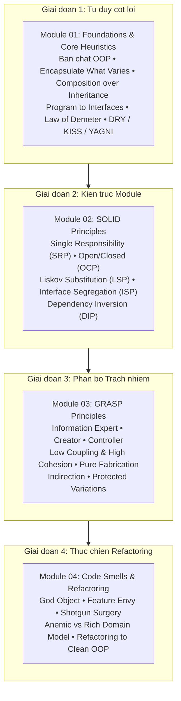

# Object-Oriented Design Principles

Mọi phần mềm khi mới bắt đầu đều đẹp và tinh gọn. Nhưng khi yêu cầu nghiệp vụ tăng dần theo thời gian, mã nguồn thường bắt đầu thoái hóa: một thay đổi nhỏ làm gãy vỡ các module không liên quan (**Fragility**), việc sửa đổi trở nên nặng nề và tốn kém (**Rigidity**), và các đoạn mã bị dính chặt vào ngữ cảnh hiện tại không thể tái sử dụng (**Immobility**).

Hệ thống **Object-Oriented Design Principles (Nguyên lý thiết kế hướng đối tượng)** ra đời không phải để đặt ra thêm quy tắc cứng nhắc, mà là **bộ quy tắc chỉ dẫn (heuristics)** giúp kỹ sư kiểm soát độ phức tạp (complexity) và hạ thấp chi phí thay đổi (cost of change) trong vòng đời phần mềm.

---

## Bản đồ Lộ trình Học tập

---

## Cấu trúc 4 Modules Chuyên sâu

### Module 01 — Foundations & Core Heuristics
Nền móng tư duy thiết kế trước khi đi vào các quy tắc cụ thể:
- **Bản chất OOP & Chi phí của sự thay đổi:** Tại sao code bị thoái hóa? Phân tích bộ ba triệu chứng: Cứng nhắc (Rigidity), Dễ vỡ (Fragility), Bất động (Immobility).
- **Encapsulate What Varies:** Xác định các trục biến động và cô lập chúng đằng sau abstraction.
- **Composition over Inheritance:** Tại sao kế thừa lớp cha thường dẫn đến "White-box reuse" dễ vỡ và cách giải quyết bằng cơ chế ủy thác (*Delegation/Has-a*).
- **Program to Interfaces, not Implementations:** Lập trình dựa trên hợp đồng giao diện, tách rời người gọi và đối tượng thực thi.
- **Law of Demeter (LoD):** Nguyên lý ít hiểu biết nhất — chỉ nói chuyện với bạn thân, triệt tiêu chuỗi gọi lồng nhau.
- **DRY, KISS & YAGNI trong bối cảnh OOP:** Đánh giá đúng ranh giới giữa tái sử dụng logic và over-engineering trừu tượng hóa sớm.

### Module 02 — Bộ ngũ nguyên lý SOLID
Tiêu chuẩn vàng trong thiết kế module và phân rã trách nhiệm:
- **SRP (Single Responsibility):** Một class chỉ nên có một lý do duy nhất để thay đổi. Hiểu đúng về vai trò của "Actor" (tác nhân nghiệp vụ).
- **OCP (Open/Closed):** Mở để mở rộng nhưng đóng để sửa đổi. Thiết kế plugin và đa hình bảo vệ code lõi.
- **LSP (Liskov Substitution):** Thay thế hành vi (Behavioral Subtyping). Cách nhận diện vi phạm kế thừa (bài toán Square - Rectangle).
- **ISP (Interface Segregation):** Tránh "Fat Interface". Client không bị ép buộc phải phụ thuộc vào method nó không dùng.
- **DIP (Dependency Inversion):** Module cấp cao không phụ thuộc module cấp thấp, cả hai cùng phụ thuộc vào abstraction. Ranh giới kiến trúc thực sự.

### Module 03 — Hệ thống gán trách nhiệm GRASP
Trả lời câu hỏi cốt lõi: *"Nên giao trách nhiệm (Method/Logic) này cho Class nào?"*:
- **Information Expert:** Giao việc cho nơi nắm giữ thông tin cần thiết nhất để hoàn thành nó.
- **Creator:** Ai nên tạo ra đối tượng B? Xác định quan hệ sở hữu và vòng đời.
- **Controller:** Tiếp nhận sự kiện hệ thống từ UI và điều phối use-case mà không làm bẩn domain logic.
- **Low Coupling & High Cohesion:** Hai thước đo sinh tử để đánh giá chất lượng thiết kế kiến trúc.
- **Pure Fabrication & Indirection:** Tạo ra các khái niệm ảo (Service, Repository, Factory) khi thế giới thực không đủ mô hình hóa.
- **Protected Variations:** Thiết kế điểm tựa chống lại các biến động không lường trước.

### Module 04 — Code Smells & Kỹ thuật Refactoring
Nhận diện bệnh tật của mã nguồn và phẫu thuật tái cấu trúc:
- **God Object (The Blob):** Nhận diện class ôm đồm quá nhiều việc và lộ trình tách nhỏ an toàn.
- **Feature Envy & Shotgun Surgery:** Thèm muốn dữ liệu class khác và phẫu thuật đạn chùm khi mỗi lần sửa một tính năng phải chạm vào chục file.
- **Anemic Domain Model vs Rich Domain Model:** Tranh biện mô hình thiếu máu (chỉ có getter/setter) và mô hình trọn vẹn nghiệp vụ.
- **Refactoring to Clean OOP:** Quy trình từng bước biến legacy code thành mã nguồn tuân thủ Design Principles thông qua Unit Test và vi tái cấu trúc (Micro-refactorings).

---

## Chuẩn mực học tập & Ứng dụng
- Mỗi bài học đều xuất phát từ **Vấn đề thực tế (Problem)** trước khi giới thiệu nguyên lý.
- Luôn phân tích **Trade-off (Sự đánh đổi)**: Không có nguyên lý nào là "viên đạn bạc". Khi áp dụng nguyên lý sẽ tăng số lượng interface/class, đòi hỏi cân đối giữa tính linh hoạt và độ phức tạp.
- Minh họa song song bằng code thực tế, sơ đồ lớp UML/Mermaid trực quan.
